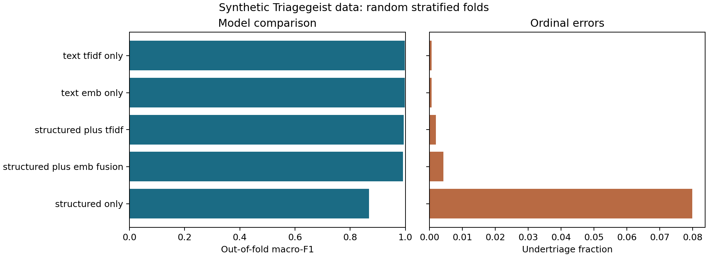

# Complaint2Concern

A side project exploring how chief-complaint text and structured intake variables contribute to emergency-triage acuity prediction on **synthetic Kaggle Triagegeist data**.

The analysis compares five approaches: structured-only CatBoost, text-only TF-IDF with logistic regression, structured plus TF-IDF, frozen MiniLM embeddings with LightGBM, and structured plus embeddings with CatBoost. It examines errors, uncertainty, disagreement between text and structured predictions, and possible shortcuts in repeated complaint wording.

**Status:** research prototype. The canonical workflow is [`notebooks/submission_notebook.ipynb`](notebooks/submission_notebook.ipynb). Measured results and the precise validation status are in [`reports/reproduced/results.md`](reports/reproduced/results.md). This is not a deployed or clinically validated system.

## What this project demonstrates

| Skill | Evidence |
| --- | --- |
| Python and heterogeneous-data integration | Validated joins of intake, complaint and history tables in `src/data_io.py` |
| Reusable preprocessing | Shared missing-text, abbreviation, structured-feature and TF-IDF transformations |
| Applied ML and NLP | Frozen SentenceTransformer embeddings, linear baselines and boosted-tree models |
| Evaluation design | Five-fold stratified validation, training-fold-only fitting, out-of-fold comparison and ordinal error metrics |
| Critical interpretation | Repeated-text diagnostics, subgroup summaries, confidence analysis and explicit limits on clinical claims |
| Software practice | Configurations, contract tests, run fingerprints, executable notebook and automated test workflow |

MiniLM runs locally and is not fine-tuned. No LLM API or agentic workflow is implemented here. Developed as a team project; the capabilities above describe the shared work.

## Reproduce the analysis

Use Python 3.11. Commands below run from the repository root.

```bash
python -m venv .venv
source .venv/bin/activate
python -m pip install -r requirements.txt -r requirements-notebooks.txt
python -m unittest discover -s tests -v
python -m scripts.run_notebook --output-dir outputs/reproduced
```

Before running, obtain the competition files through [Kaggle Triagegeist](https://www.kaggle.com/competitions/triagegeist) and follow [`data/README.md`](data/README.md). The first MiniLM use needs access to Hugging Face to download model weights; subsequent runs can use a local cache. Full cross-validation trains 25 classifiers and may take appreciable time on a CPU. The tested package versions are recorded in the run manifest and [`requirements-tested.txt`](requirements-tested.txt).

To refresh the public aggregate evidence after a full run:

```bash
python -m scripts.publish_results --run-dir outputs/reproduced --report-dir reports/reproduced
```

The runner starts a fresh kernel and stops on any error. It saves an executed notebook, exact aggregate CSV tables, a results report, private OOF arrays and a run manifest. The manifest records code/data SHA-256 fingerprints, package versions, model revision, seed, split configuration and artifact checksums. Review figures are saved alongside the run. Raw data, per-row outputs, models and local submissions are ignored by Git.

Options:

```bash
# A small functional run, not a source of full-data performance claims
python -m scripts.run_notebook --sample 1000 --folds 2 --output-dir outputs/smoke

# Also produce the historical selected fusion fold-ensemble predictions
python -m scripts.run_notebook --submission --output-dir outputs/reproduced

# Optional UMAP projections; these are not required for model evaluation
python -m scripts.run_notebook --projections --output-dir outputs/with-projections
```

Repeated complaints are encoded once because the pretrained encoder is frozen. Structured preprocessing, TF-IDF vocabulary and classifiers are fitted on training rows within each fold.



## Reading the results

- Compare models using both out-of-fold metrics and fold mean/standard deviation.
- Acuity 1 is most urgent. Undertriage means `prediction > true`; severe undertriage means a difference of at least two levels.
- Text-only methods can outperform fusion. The optional submission keeps the historical fusion choice; it is not an assertion of superiority.
- Confidence/disagreement thresholds are descriptive quantiles of the evaluated predictions, not a prospectively tuned clinical policy.
- Feature importance is model-specific. Modality importance shares and embedding anchors are exploratory associations, not causal or token-level explanations.
- Subgroup summaries do not establish fairness or transfer to new hospitals.

## Completed and future work

See [`reports/validation_status.md`](reports/validation_status.md) for the measured execution record. The default run includes model comparison, ordinal metrics, feature/term summaries, exploratory embedding anchors, clustering, confidence/concern-gap summaries, simple text perturbations and subgroup/duplicate-text diagnostics.

Site-held-out and shuffled-text control cells are retained as optional experiments and disabled by default. Unseen-complaint-group validation, independent threshold selection, external clinical validation and deployment remain future work. Local SHAP is not part of the verified workflow. Synthetic wording and duplicates can inflate random-fold scores.

## Additional entry points

The following are simpler **single-split** baselines. They do not reproduce the five-fold report or final fold ensemble:

```bash
python -m src.train_baseline --config configs/base.yaml
python -m src.train_fusion --config configs/minilm_catboost.yaml
python -m scripts.export_submission --config configs/minilm_catboost.yaml
```

For Kaggle, use [`notebooks/submission_notebook_kaggle.ipynb`](notebooks/submission_notebook_kaggle.ipynb) and [`kaggle/final_submission_manifest.md`](kaggle/final_submission_manifest.md). The Kaggle variant shares the analysis cells and has a platform-specific bootstrap; it requires separate verification inside Kaggle. No competition upload or leaderboard result is asserted by this repository.

## Repository map

```text
configs/                input paths and single-split model configuration
src/                    shared preprocessing, features, training and evaluation
scripts/run_notebook.py  canonical fresh-kernel execution
notebooks/              analysis and Kaggle variants
reports/reproduced/      reviewed aggregate results and figures
reports/archive/         historical draft material, not current results
tests/                   invented-data contracts and prediction smoke test
data/README.md           input acquisition and schema
```

Source reuse rights have not been explicitly licensed. Competition data and pretrained models retain their own terms. A licence should be chosen with the contributors before granting reuse permissions.
